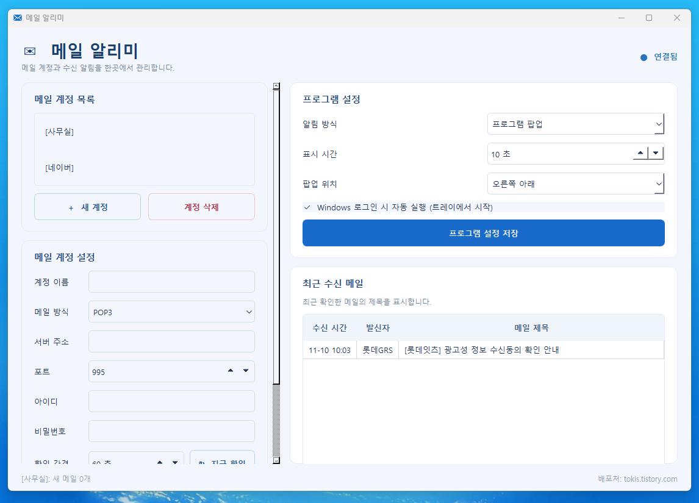

# 메일 알리미 (Mail Notifier)

Windows용 **PySide6 시스템 트레이 메일 알림 프로그램**입니다.  IMAP/POP3 계정의 새 메일을 확인하고 제목, 발신자 이름, 수신 시각, 본문 앞부분을 알림으로 보여줍니다.

## 주요 기능

- IMAP / POP3 SSL/TLS 연결, 여러 메일 계정 관리
- Windows 기본 알림 또는 자체 팝업 알림 (팝업 위치 / 표시 시간 설정)
- 메일 제목, 발신자 이름, 연도 없는 수신 시각, 본문 최대 3줄 표시
- 다음·네이버·Gmail 알림 클릭 시 웹메일 열기 / 트레이 메뉴 바로가기
- Windows 로그인 시 시스템 트레이에 자동 시작 (`--tray`)
- 실행 중 확인한 최근 수신 메일 제목 목록
- 프로그램 실행 파일 옆에 `settings.json`, `credentials.json` 저장
- 저장된 비밀번호는 Windows DPAPI로 암호화 (다른 PC·Windows 사용자로 옮기면 재입력 필요)
- 전체 계정 및 설정 초기화

## 사용 안내

1. EXE를 **쓰기 가능한 폴더**(예: 사용자 문서 폴더)에 놓고 실행합니다.
2. 메일 계정명, 서버 주소, 포트(일반적인 IMAP SSL 993 / POP3 SSL 995), 아이디, 비밀번호를 입력하고 **계정 저장**을 누릅니다.
3. **프로그램 설정 저장**으로 알림 방식, 표시 시간, 자동 실행 등을 저장합니다.
4. 창을 닫으면 트레이에 상주하며, 트레이 우클릭으로 계정 확인·웹메일 열기·종료를 사용할 수 있습니다.

일부 서비스는 메일 앱 비밀번호나 POP3/IMAP 허용 설정이 필요합니다. Windows 기본 알림의 실제 노출 시간은 운영체제가 제한할 수 있습니다.

## 설정 파일 / 개인정보

- `settings.json`: 계정명, 서버, 설정 및 확인 기록. **메일 주소 등 개인정보가 일반 텍스트로 들어갈 수 있으므로 공개 저장소에 올리지 마세요.**
- `credentials.json`: Windows 사용자별 DPAPI 암호화된 비밀번호. 암호화되어도 외부에 공개하지 마세요.
- 저장된 메일 설정은 EXE 파일과 같은 폴더에 존재합니다. Git에 포함되지 않도록 `.gitignore`에 등록했습니다.
- 기존 설정을 유지하려면 프로그램 종료 후 새 EXE만 같은 폴더에 교체합니다.

## 보안·검증 참고

- GitHub Actions 빌드에 개인 메일 계정이나 비밀번호를 입력할 필요가 없습니다.
- 이 패키지의 소스 문법 검사 및 정적 파일 검사는 수행했으나, **Windows 환경에서 실제 실행·메일 서버 연결·프리징 해소를 보장하지 않습니다.**
- 추가 라이선스는 임의로 설정하지 않았습니다. **제3자가 재배포하거나 수정할 수 있는 허가 범위는 저장소 소유자가 직접 정해야 합니다.** 사용한 라이브러리·아이콘의 제3자 라이선스도 확인하세요.

**배포처:** tokis.tistory.com
